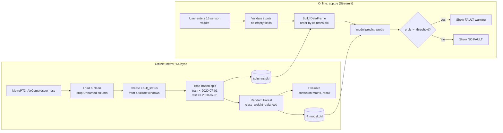

# System Design

## 1. Overview

Two stages: an **offline training pipeline** (notebook) and an **online inference app** (Streamlit). They share two artifacts: the trained model and the feature column list.

## 2. Components

| Component | File | Responsibility |
|---|---|---|
| Data source | `MetroPT3_AirCompressor_.csv` | Raw sensor logs (not in repo) |
| Training pipeline | `MetroPT3.ipynb` | Labelling, splitting, training, evaluation, saving artifacts |
| Model artifact | `rf_model.pkl` | Serialized Random Forest |
| Schema artifact | `columns.pkl` | Feature names and order expected by the model |
| Web app | `app.py` | Input form, validation, inference, result display |

## 3. Data flow

**Training**
1. Read CSV, parse `timestamp`, drop the `Unnamed` index column.
2. Label rows: `1` inside the four failure windows, else `0`.
3. Split by time so the test set is a future period (prevents leakage).
4. Drop `timestamp` and `Fault_status` from the features, train the Random Forest, evaluate.
5. Save the model and the feature list with `joblib`.

**Inference**
1. User fills 7 numeric fields and 8 signal selectors.
2. App rejects empty numeric fields.
3. Values go into a one-row DataFrame, columns are reordered to match `columns.pkl`.
4. `predict_proba` gives the fault probability; the threshold (default 0.2) decides the message.

## 4. Design decisions

| Decision | Reason |
|---|---|
| Time-based split | Rows are seconds apart; random splits leak near-duplicates into the test set |
| `class_weight="balanced"` | Faults are about 2% of rows; avoids a huge oversampled dataset |
| Random Forest over KNN | Small model file, fast prediction; KNN stores the whole training set |
| No scaler | Tree models do not need feature scaling, so there is one less artifact |
| Probability + threshold | Rare-class detection needs a tunable trade-off, not a fixed 0.5 |
| Shared `columns.pkl` | Guarantees the app builds features in the same order as training |

## 5. Known limitations

- Single-row prediction with no temporal context.
- Poor generalisation to unseen failure types (recall 0% on the July fault).
- Labels are time windows, not per-sensor anomaly flags; the model partly learns "compressor is idle".

## 6. Deployment

- **Local:** `streamlit run app.py`
- **Streamlit Community Cloud:** push the repo to GitHub, point the platform at `app.py`. `rf_model.pkl`, `columns.pkl` and `requirements.txt` must be in the repo. Keep each file well under GitHub's 100 MB limit (use `joblib.dump(..., compress=3)`).
